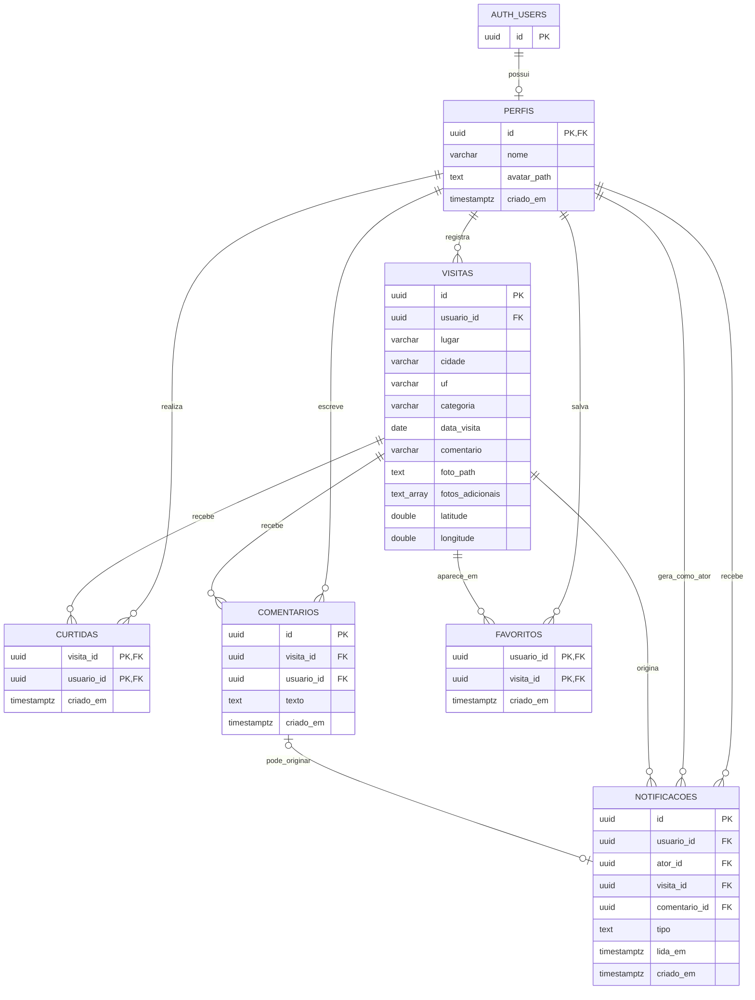

# Passaporte Local

Projeto de [Artur-Txr](https://github.com/Artur-Txr).

Aplicativo mobile para registrar passeios, guardar fotos e compartilhar descobertas pelo Brasil. Cada visita reúne o lugar, a cidade, a data e as lembranças do passeio. A comunidade permite conhecer outros viajantes, curtir publicações e comentar.

[Abrir o protótipo](https://artur-txr.github.io/passaporte-local/)


## Recursos

- Cadastro, login e recuperação de senha.
- Perfil com nome e fotografia.
- Visitas com até cinco fotos e escolha da capa.
- Busca por lugar ou cidade e filtros por categoria.
- Publicações, perfis públicos, curtidas e comentários.
- Lista Quero conhecer para salvar lugares.
- Notificações de interações nas próprias visitas.
- Mapa com marcação manual, busca por nome ou endereço e localização atual no cadastro e na edição.
- Localização e abertura de rota nos detalhes das visitas.
- Rascunhos dos textos de visitas e comentários.
- Otimização das novas fotografias antes do envio.

A identidade visual usa azul-petróleo, coral e a fonte Manrope.

## Tecnologias

React Native, Expo SDK 57, TypeScript, Expo Router e Supabase. Os mapas usam Leaflet e OpenStreetMap. A busca de lugares usa Photon, e a posição atual usa Expo Location.

## Executar o aplicativo

Use Node.js 24 e instale as dependências pelo lockfile.

```bash
npm ci
```

Copie `.env.example` para `.env.local` e configure a URL e a chave pública do projeto Supabase.

### Celular Android

Instale o Expo Go compatível com o SDK 57. Conecte o celular e o computador à mesma rede e execute:

```bash
npx expo start --lan
```

Escaneie o QR code pelo Expo Go. Para recarregar o app, pressione `r` no terminal.

### BlueStacks

Abra o Expo Go 57 no emulador e execute no computador:

```bash
npx expo start --localhost
```

No Expo Go, use `exp://10.0.2.2:8081`. Se o terminal informar outra porta, ajuste o endereço.

Os arquivos `Iniciar-BlueStacks.cmd`, `Iniciar-Celular-WiFi.cmd` e `Iniciar-PC.cmd` também estão disponíveis na raiz.

## Localização das visitas

No cadastro ou na edição, toque em Selecionar localização. Você pode usar a localização atual, buscar um lugar incluindo a cidade ou tocar diretamente no mapa. Confira o ponto e confirme antes de salvar a visita.

A permissão de localização é solicitada ao tocar em Usar localização atual. O aplicativo exibe a precisão informada pelo aparelho. A busca de lugares depende de internet e consulta o serviço público Photon somente ao solicitar a pesquisa, com cache temporário de resultados.

## Supabase

Para configurar um projeto novo, aplique os arquivos de `supabase/migrations/` em ordem. Em seguida, aplique uma vez cada arquivo abaixo:

1. `supabase/comunidade-social.sql`
2. `supabase/perfis-publicos-e-categorias.sql`
3. `supabase/resumo-viajante.sql`
4. `supabase/busca-lugares.sql`
5. `supabase/favoritos-notificacoes-localizacao.sql`
6. `supabase/login-google.sql`

As visitas são visíveis para contas conectadas. A edição fica restrita ao autor. Favoritos são pessoais, e cada conta recebe suas próprias notificações. O acesso às fotos é feito por URLs assinadas.

Os textos dos rascunhos ficam no aparelho. O mapa mostra as visitas que têm uma localização marcada. Login, sincronização, publicações e carregamento do mapa usam internet.

## Modelo lógico do banco de dados

O aplicativo usa PostgreSQL no Supabase. As seis tabelas da aplicação ficam no schema `public`. A conta de acesso é gerenciada pelo Supabase Auth em `auth.users`, e cada conta tem um perfil vinculado pelo mesmo identificador UUID.

### Diagrama de relacionamentos

No diagrama, `PK` indica chave primária e `FK` indica chave estrangeira. O círculo representa uma relação opcional e o pé de galinha representa vários registros.



O diagrama destaca os campos principais. O dicionário abaixo inclui os campos de controle existentes no banco. `text_array` representa o tipo PostgreSQL `text[]`; `double` representa `double precision`.

### Perfis

Identifica o viajante que aparece nas publicações e nos comentários.

| Campo | Tipo | Função |
|---|---|---|
| `id` | `uuid` | PK e FK para `auth.users.id`. |
| `nome` | `varchar(80)` | Nome exibido no aplicativo. |
| `avatar_path` | `text`, opcional | Caminho da fotografia do perfil. |
| `criado_em` | `timestamptz` | Data e hora da criação do perfil. |

O perfil é criado junto da conta. A alteração do nome no Supabase Auth é sincronizada com `perfis.nome`.

### Visitas

Guarda o registro de um lugar visitado e sua lembrança.

| Campo | Tipo | Função |
|---|---|---|
| `id` | `uuid` | PK da visita. |
| `usuario_id` | `uuid` | FK para `perfis.id`, identificando o autor. |
| `lugar` | `varchar(120)` | Nome do lugar. |
| `cidade` | `varchar(100)` | Cidade informada no cadastro. |
| `uf` | `varchar(2)` | Sigla do estado. |
| `categoria` | `varchar(20)` | Uma das 13 categorias disponíveis. |
| `data_visita` | `date` | Data do passeio. |
| `comentario` | `varchar(500)` | Lembrança escrita pelo autor da visita. |
| `foto_path` | `text`, opcional | Caminho da fotografia de capa. |
| `fotos_adicionais` | `text[]` | Caminhos de até quatro fotografias adicionais, na ordem do álbum. |
| `latitude`, `longitude` | `double precision`, opcionais | Coordenadas escolhidas no mapa. |
| `criado_em`, `atualizado_em` | `timestamptz` | Controle da criação e da última alteração. |
| `origem_colecao` | `integer`, opcional | Identificador da importação da coleção inicial, para evitar duplicidade por autor. |
| `busca_texto` | `text`, gerado | Combina lugar, cidade e UF em minúsculas e sem acentos para a busca. |
| `avaliacao` | `smallint`, opcional | Campo legado para compatibilidade com registros antigos. A avaliação foi retirada da interface. |

Cada visita pertence a um perfil, e um perfil pode registrar várias visitas. O álbum comporta uma capa e até quatro fotos adicionais. Latitude e longitude são preenchidas juntas e passam por validação de intervalo.

### Curtidas

Relaciona quem curtiu uma visita com a publicação correspondente.

| Campo | Tipo | Função |
|---|---|---|
| `visita_id` | `uuid` | FK para `visitas.id` e parte da PK composta. |
| `usuario_id` | `uuid` | FK para `perfis.id` e parte da PK composta. |
| `criado_em` | `timestamptz` | Momento da curtida. |

A PK `(visita_id, usuario_id)` garante uma curtida por conta em cada visita. A relação entre perfis e visitas é muitos para muitos, resolvida pela tabela `curtidas`.

### Comentários

Guarda as mensagens da comunidade em uma visita.

| Campo | Tipo | Função |
|---|---|---|
| `id` | `uuid` | PK do comentário. |
| `visita_id` | `uuid` | FK para `visitas.id`. |
| `usuario_id` | `uuid` | FK para `perfis.id`, identificando quem escreveu. |
| `texto` | `text` | Conteúdo com validação de 1 a 500 caracteres após remover espaços nas extremidades. |
| `criado_em` | `timestamptz` | Data e hora do comentário. |

Uma visita pode receber vários comentários, e um perfil pode escrever vários comentários na mesma visita.

### Favoritos

Representa a lista pessoal Quero conhecer.

| Campo | Tipo | Função |
|---|---|---|
| `usuario_id` | `uuid` | FK para `perfis.id` e parte da PK composta. |
| `visita_id` | `uuid` | FK para `visitas.id` e parte da PK composta. |
| `criado_em` | `timestamptz` | Momento em que o lugar foi salvo. |

A PK `(usuario_id, visita_id)` impede salvar a mesma visita duas vezes na lista da mesma pessoa. Essa tabela também resolve uma relação muitos para muitos entre perfis e visitas.

### Notificações

Registra as interações recebidas pelo autor de uma visita.

| Campo | Tipo | Função |
|---|---|---|
| `id` | `uuid` | PK da notificação. |
| `usuario_id` | `uuid` | FK para `perfis.id`, identificando o destinatário. |
| `ator_id` | `uuid` | FK para `perfis.id`, identificando quem interagiu. |
| `visita_id` | `uuid` | FK para `visitas.id`. |
| `comentario_id` | `uuid`, opcional | FK para `comentarios.id`, preenchida nas notificações de comentário. |
| `tipo` | `text` | Tipo da interação, `curtida` ou `comentario`. |
| `lida_em` | `timestamptz`, opcional | Momento da leitura. O valor vazio indica uma notificação não lida. |
| `criado_em` | `timestamptz` | Momento da geração da notificação. |

Gatilhos do banco criam notificações para interações de outras pessoas. Índices únicos evitam duplicar a notificação da mesma curtida ou do mesmo comentário. Uma notificação de curtida tem `comentario_id` vazio. Cada comentário pode originar no máximo uma notificação.

### Integridade, arquivos e acesso

- As FKs usam `ON DELETE CASCADE`. A exclusão de uma visita remove suas curtidas, comentários, favoritos e notificações associados.
- As tabelas usam Row Level Security (RLS). Perfis e visitas podem ser consultados por contas conectadas. A edição do perfil e da visita é permitida ao próprio autor.
- Cada pessoa pode criar e remover suas curtidas e comentários. A lista de favoritos é acessível ao dono da conta, e as notificações são acessíveis ao destinatário.
- As fotografias ficam no Supabase Storage, nos buckets `fotos-visitas` e `avatares`. Os campos de caminho guardam referências aos arquivos, e o aplicativo obtém URLs assinadas para exibi-los.
- Os rascunhos de texto ficam no AsyncStorage do aparelho. Eles são separados por conta e por formulário.

## Testes

```bash
npm test
npm run typecheck
npm run verificar:prototipo
```

A versão de 14 de novembro de 2026 passou nos 27 testes automatizados, na checagem do TypeScript e nas exportações Android e web. As regras de acesso e os fluxos de interação também foram verificados no Supabase. A conferência dos novos fluxos no celular está pendente.

## Organização

- `src/app/` reúne as telas.
- `src/componentes/` contém os componentes compartilhados.
- `src/servicos/` concentra as operações de dados, fotos e comunidade.
- `supabase/` guarda os SQL do banco.
- `tests/` contém os testes automatizados.
- `docs/` contém o protótipo em HTML, CSS e JavaScript publicado no GitHub Pages.
- `historico/` reúne os registros das etapas anteriores.

O protótipo apresenta 17 telas e estados de navegação. Ele tem armazenamento no navegador e um fluxo de acesso próprio. O aplicativo mobile usa a conta e os serviços do Supabase.
